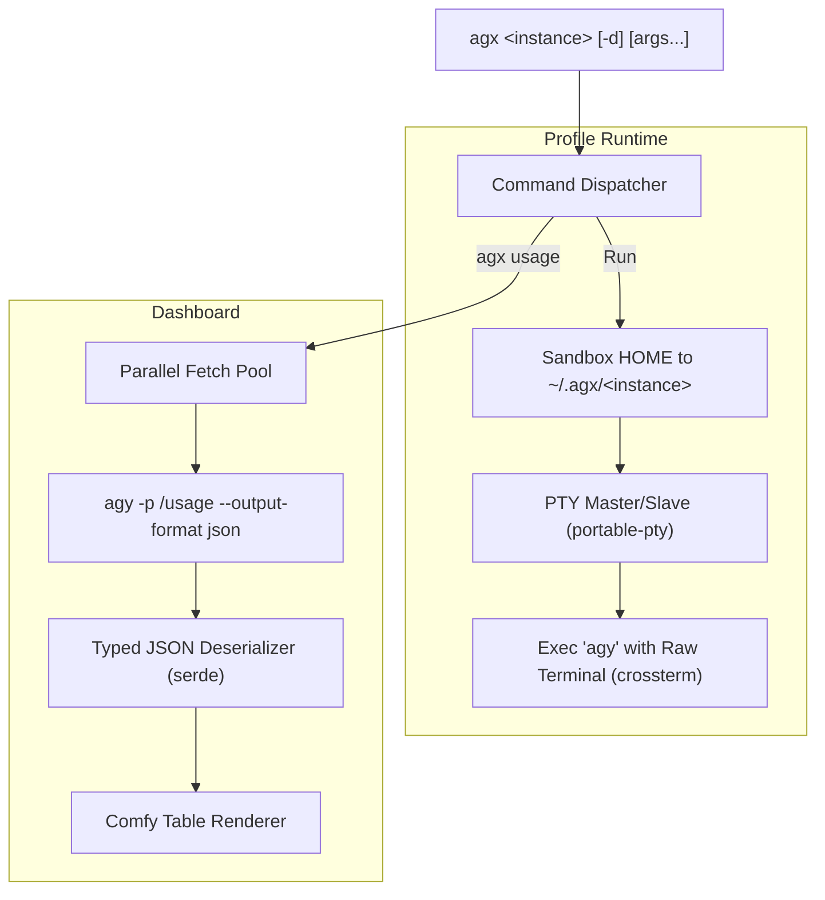

<div align="center">


# ⚡ `agx`
### Multi-Account & Profile Manager for Google Antigravity (`agy`)

[](https://www.rust-lang.org)
[](https://crates.io/crates/portable-pty)
[](https://crates.io/crates/comfy-table)
[](LICENSE)

*Seamlessly isolate, switch, and monitor quotas across unlimited `agy` developer accounts.*

</div>

---

## ✨ Features

- 🌌 **Zero-Leak Profile Isolation**: Transparently sandboxes environments by managing isolated user homes at `~/.agx/<instance-name>`.
- 🕹️ **Full Interactive PTY**: Powered by `portable-pty` & `crossterm` with raw mode passthrough, real-time terminal resize tracking, and interactive ANSI handling.
- 🚀 **Streamlined Flag Mapping**: Shorthand `-d` auto-expands to `--dangerously-skip-permissions` for frictionless execution.
- 🩺 **Health Check & Ping (`agx ping` & `agx <instance> ping`)**:
  - Probes instances via validation prompts (`agy --prompt "whats between 1 and 3"`).
  - Measures round-trip latency and diagnoses auth errors or connectivity issues.
  - Formats results into a clean, colored status table.
- 📊 **Real-time Quota Dashboard (`agx usage`)**:
  - Queries quotas concurrently across all configured profiles.
  - Parses native `json` data structures (`gemini-weekly`, `5h`, `3p-weekly`, etc.).
  - Gorgeous rounded unicode tables with color-graded visual progress bars (`[████████░░] 80%`).
  - Total fleet aggregate calculation with average limit remaining.

---

## 🚀 Installation

### From Source

```bash
# Clone the repository
git clone https://github.com/your-username/agx.git
cd agx

# Build optimized release binary
cargo build --release

# Install globally to your PATH
cp target/release/agx /usr/local/bin/ # or ~/.cargo/bin/
```

---

## 💻 Usage

```text
agx - Multi-account manager & wrapper for agy

USAGE:
    agx <instance-name> [args...]    Run agy with HOME=~/.agx/<instance-name>
    agx <instance-name> enable       Enable a previously disabled instance
    agx <instance-name> disable      Disable an instance from runs & quota checks
    agx <instance-name> ping         Ping instance to check health
    agx usage                        Display usage quotas for all instances
    agx ping                         Ping all instances to check health
    agx add <instance-name>          Create a new instance environment
    agx list                         List all configured instances
    agx --help, -h                   Show this help message

OPTIONS FOR RUN:
    -d                               Passes '--dangerously-skip-permissions' to agy
    [args...]                        All other arguments are forwarded directly to agy
```

### 1. Launch / Switch Instances
Run any session under a dedicated profile. If the profile doesn't exist, `agx` provisions it on the fly:

```bash
# Launch interactive agy shell under 'work' profile
agx work

# Launch with permissions bypassed (-d maps to --dangerously-skip-permissions)
agx work -d

# Forward commands directly to agy
agx personal chat "explain quantum computing"
```

### 2. Enable / Disable Accounts
Easily disable an account to prevent accidental runs or quota consumption, or re-enable it at any time:

```bash
# Temporarily disable an account
agx client-a disable

# Re-enable the account
agx client-a enable
```

### 3. Manage Profiles

```bash
# Explicitly initialize an account profile
agx add client-a

# List all local instances (shows (disabled) status next to disabled accounts)
agx list
```

### 4. Fleet-wide Usage Quota Dashboard

```bash
agx usage
```

#### Output Preview:
```text
Fetching usage for 2 instance(s)...

╭──────────┬───────────────────────┬───────────────────────────┬───────────┬──────────────────────┬─────────────╮
│ Instance │ Model Family          │ Quota / Limit             │ Remaining │ Progress             │ Resets At   │
├──────────┼───────────────────────┼───────────────────────────┼───────────┼──────────────────────┼─────────────┤
│ work     │ Gemini Models         │ Weekly Limit Remaining    │       68% │ [█████████░░░░░] 68% │ in 5d 1h    │
│          │ Gemini Models         │ Five Hour Limit Remaining │       98% │ [█████████████░] 98% │ in 4h 51min │
│          │ Claude and GPT models │ Weekly Limit Remaining    │      100% │ [██████████████] 100%│ in 6d 23h   │
│          │ Claude and GPT models │ Five Hour Limit Remaining │      100% │ [██████████████] 100%│ in 4h 55min │
├──────────┼───────────────────────┼───────────────────────────┼───────────┼──────────────────────┼─────────────┤
│ personal │ Gemini Models         │ Weekly Limit Remaining    │       95% │ [█████████████░] 95% │ in 6d 3h    │
│          │ Gemini Models         │ Five Hour Limit Remaining │      100% │ [██████████████] 100%│ in 1h 28min │
╰──────────┴───────────────────────┴───────────────────────────┴───────────┴──────────────────────┴─────────────╯

╭───────────────────────────────┬───────────────────────────┬───────────┬───────────────┬──────────────────╮
│ Total Aggregated (Average)    │ Quota / Limit             │ Instances │ Avg Remaining │ Progress         │
├───────────────────────────────┼───────────────────────────┼───────────┼───────────────┼──────────────────┤
│ Gemini Models                 │ Weekly Limit Remaining    │     2     │           81% │ [█████████████░░]│
│ Gemini Models                 │ Five Hour Limit Remaining │     2     │           99% │ [███████████████]│
│ Claude and GPT models         │ Weekly Limit Remaining    │     2     │          100% │ [███████████████]│
╰───────────────────────────────┴───────────────────────────┴───────────┴───────────────┴──────────────────╯
```

### 5. Fleet & Instance Health Check (`ping`)

Ping all accounts concurrently or target a single instance to verify responsive connectivity and authentication status:

```bash
# Ping all configured instances
agx ping

# Ping a single specific instance
agx work ping
```

#### Output Preview:
```text
Pinging 3 instance(s)...

╭──────────┬──────────────┬─────────┬──────────────────────────────────╮
│ Instance │ Status       │ Latency │ Response / Message               │
├──────────┼──────────────┼─────────┼──────────────────────────────────┤
│ work     │ ● Healthy    │   1.84s │ **2** (or the word "and").       │
│ personal │ ● Healthy    │   2.10s │ **2** (as an integer).           │
│ client-a │ ● Disabled   │       - │ -                                │
╰──────────┴──────────────┴─────────┴──────────────────────────────────╯

Summary: 2 healthy, 0 unhealthy, 1 disabled (Total: 3)
```

---

## 🛠️ Architecture



---

## 💖 Support & Donate

If `agx` makes your development workflow smoother, feel free to support ongoing maintenance and feature development!

<div align="center">

### EVM Multi-Chain Donation Address
**Supported Chains:** Ethereum (`ETH`), Polygon (`MATIC`/`POL`), BNB Smart Chain (`BNB`), Arbitrum (`ARB`)

```text
0xA111d8c3De9f45f4C4a639451630a7A243cf4A17
```

[](#-support--donate)
[](#-support--donate)
[](#-support--donate)
[](#-support--donate)

</div>

---

## 📄 License

MIT © [agx contributors](LICENSE)
